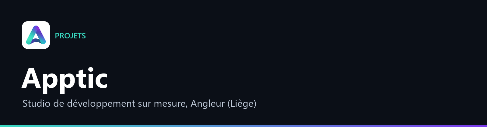
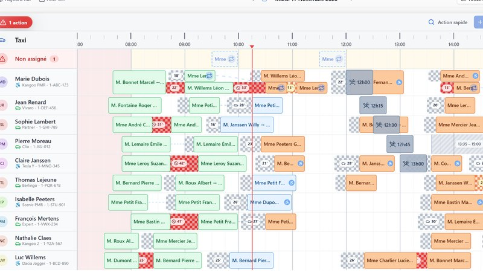
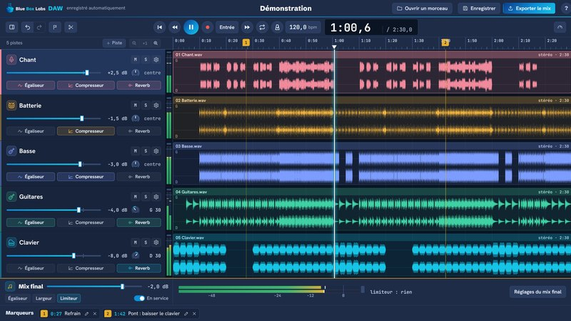

  

# Apptic

Apptic conçoit, développe et héberge des logiciels métier et des applications sur mesure pour des PME, des ASBL, des CPAS et des communes. Studio indépendant installé à Angleur, près de Liège.

Site : [apptic.be](https://apptic.be) · Contact : info@apptic.be

> Ces dépôts présentent les projets, leurs fonctionnalités et leurs évolutions. Les codes sources restent propriétaires.

## Projets

<table>
  <tr>
    <td width="50%" valign="top">
      
      <h3><a href="https://github.com/bastienbrasseur/apptic-timeshifter">Time Shifter</a></h3>
      
Planning partagé entre le bureau et les équipes de terrain : transport de personnes, chantiers, application mobile qui continue sans réseau. En production dans un CPAS wallon depuis mars 2026, à la suite d'un marché public.

      
React · TypeScript · PHP · MySQL · PWA · Tauri

    </td>
    <td width="50%" valign="top">
      
      <h3><a href="https://github.com/bastienbrasseur/apptic-ligne-43">Ligne 43</a></h3>
      
Simulateur de train dans le navigateur, de Liège-Guillemins à Esneux. Le monde est reconstruit à partir de données ouvertes, les trains et les gares sont générés par le code, tout le son est synthétisé. <a href="https://ligne43.angleur.net">Jouable en ligne</a>.

      
Three.js · TypeScript · Web Audio · données ouvertes

    </td>
  </tr>
  <tr>
    <td width="50%" valign="top">
      
      <h3><a href="https://github.com/bastienbrasseur/bluebox-daw-versions">Blue Box DAW</a></h3>
      
Logiciel de mixage multipiste pour Windows et macOS, avec un moteur audio écrit en Rust. L'écoute et l'export passent par le même calcul : le fichier exporté sonne comme ce qui a été entendu. Développé pour Blue Box Labs. <a href="https://github.com/bastienbrasseur/bluebox-daw-versions/releases/latest">Téléchargeable</a>.

      
Rust · Tauri · React · TypeScript

    </td>
    <td width="50%" valign="top"></td>
  </tr>
</table>

## Ce que ces projets ont en commun

| Savoir-faire | Où le voir |
|---|---|
| **Un logiciel pour plusieurs organisations, une base de données par client** | Time Shifter |
| **Applications de terrain qui continuent sans réseau** | Time Shifter |
| **Barèmes réglementaires datés, appliqués par le serveur** | Time Shifter |
| **Données ouvertes belges** : OpenStreetMap, Infrabel, Géoportail de la Wallonie | Ligne 43 |
| **3D et son en temps réel dans le navigateur** | Ligne 43 |
| **Traitement du signal et temps réel en Rust** | Blue Box DAW |
| **Applications de bureau installables** | Blue Box DAW, Time Shifter |
| **Logiciels pilotables par un agent IA** | Blue Box DAW |

---

© 2026 Apptic. Tous droits réservés. Les textes et les images de ces dépôts ne peuvent pas être réutilisés sans accord écrit.
